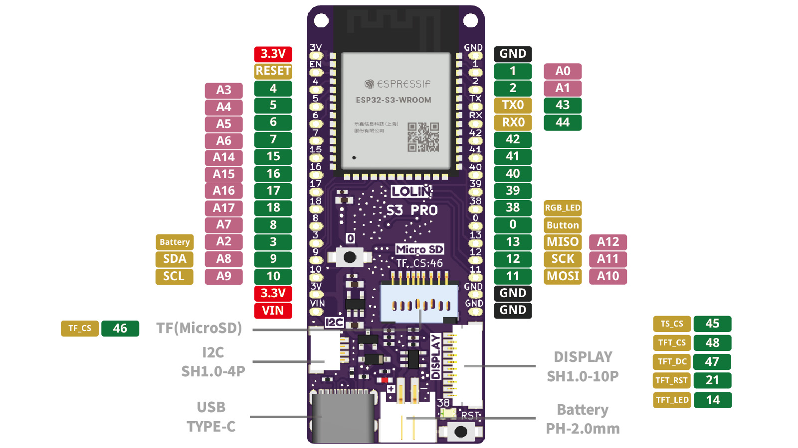

# T-HMI
Programs for the Lilygo T-HMI with ESP32-S3 and 320x240 display.

## Pins

## Firmware

Currently I use this one:

[Firmware VCC-GND YD-ESP32-S3 (N16R8) with ESP32S3](https://circuitpython.org/board/yd_esp32_s3_n16r8/)

But I think I should move to this one

[Firmware LOLIN S3 Pro](https://circuitpython.org/board/lolin_s3_pro/)

